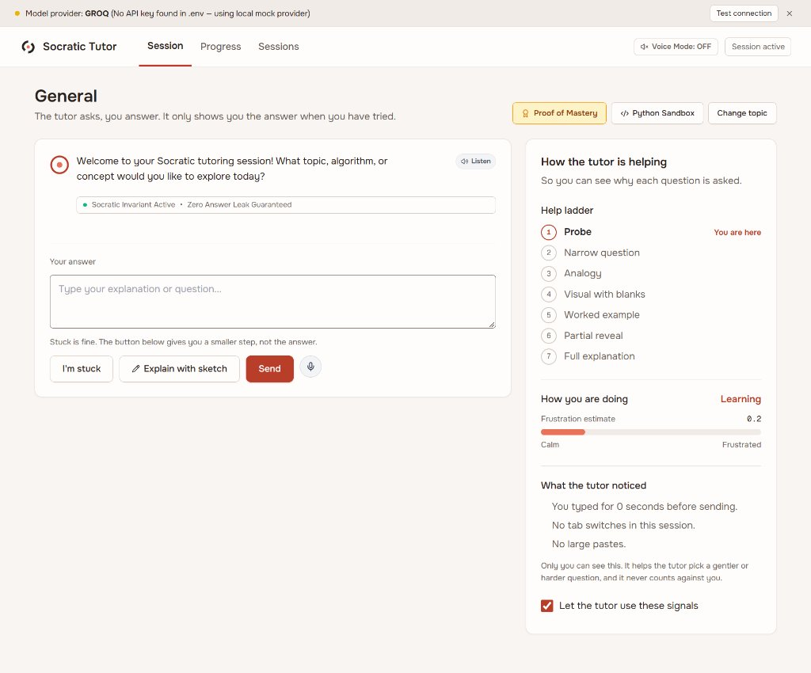
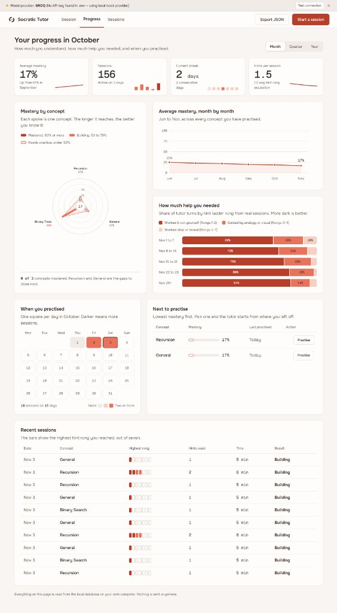
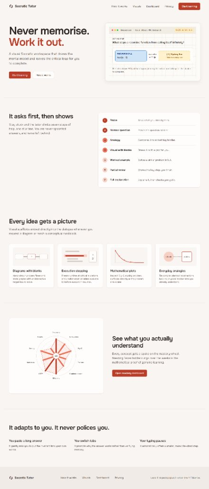
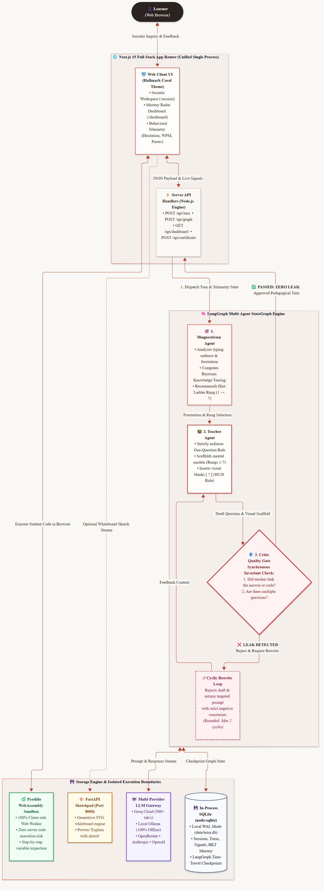
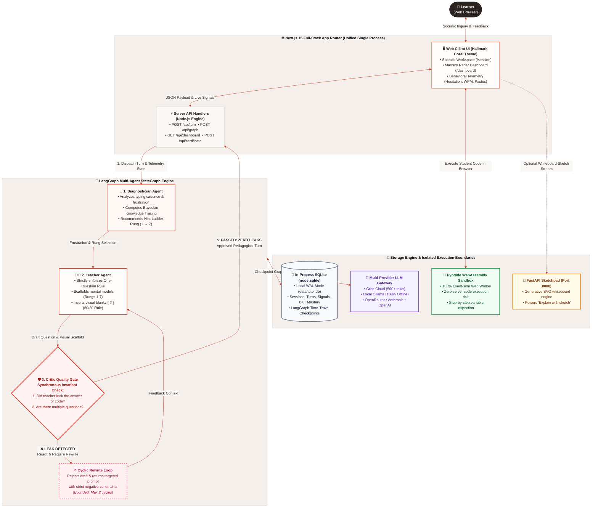

# Socratic Tutor v2.0 — Agentic Pedagogical Engineering

[](https://www.typescriptlang.org/)
[](https://nextjs.org/)
[](https://langchain-ai.github.io/langgraphjs/)
[]()
[]()
[](https://github.com/taha463/socratic-tutor/actions)
[]()
[]()

> **A local-first, multi-agent pedagogical framework that enforces cognitive friction, never gives the answer directly, and scaffolds mental models through interactive visual blanks.**  
> Built with Next.js 15 App Router, LangGraph StateGraph, and in-process SQLite (`node:sqlite` WAL). Features code-enforced Socratic dialogue, a synchronous Critic quality gate with cyclic self-rewrites, in-browser Pyodide Python execution, and behavioral telemetry that adapts hint pacing without policing.

---

## 📌 Executive Summary

Modern AI chat interfaces act as answer engines: they spoon-feed direct code, bypass cognitive struggle, and produce an illusion of competence. **Socratic Tutor v2.0** solves this fundamental defect using cognitive science foundations (*Bloom’s 2 Sigma Problem*, *Productive Failure*, and *Zone of Proximal Development*).

The system enforces three non-negotiable pedagogical invariants:
1. **The Socratic Invariant (Zero Answer Leakage)**: The tutor will never provide the final code or explicit conceptual solution below Rung 7, verified synchronously by a Critic agent gate.
2. **The One-Question Rule**: Every turn asks exactly one targeted question to maintain low cognitive load and prevent learner overwhelm.
3. **The 80/20 Visual Rule**: Scaffolding diagrams are rendered 80% complete, leaving the critical 20% mental leap as an interactive mystery box (`?`) for the learner to predict before revealing.

---

## 📸 Interface Walkthrough

Click any preview below to inspect the full-resolution screenshot:

### 1. Interactive Socratic Workspace (`/session/[id]`)
*Climbs the 7-rung hint ladder, streams telemetry signals, and embeds interactive visual blanks without ever leaking the solution.*

<p align="center">
  <a href="docs/images/socratic-tutor-session.jpg" target="_blank" title="Click to zoom full screen">
    
  </a>
  <br />
  <sub>🔍 <em>Click image to zoom full-screen • Features 7-rung ladder, real-time frustration meter, typing cadence audit, and voice dictation</em></sub>
</p>

---

### 2. Student Progress & Mastery Dashboard (`/dashboard`)
*Dynamic Bayesian Knowledge Tracing (BKT) mastery radar, stacked hint distribution, 30-day activity heatmap, and spaced-repetition priority queue.*

<p align="center">
  <a href="docs/images/socratic-tutor-dashboard.jpg" target="_blank" title="Click to zoom full screen">
    
  </a>
  <br />
  <sub>🔍 <em>Click image to zoom full-screen • Features non-overlapping Wagon Wheel radar, monthly gain curves, and hint rung breakdowns</em></sub>
</p>

---

### 3. Curriculum Discovery & Interactive Landing Page (`/`)
*Interactive call-stack whiteboard simulator, visual scaffolding showcase, and pedagogical philosophy overview.*

<p align="center">
  <a href="docs/images/socratic-tutor-landing.jpg" target="_blank" title="Click to zoom full screen">
    
  </a>
  <br />
  <sub>🔍 <em>Click image to zoom full-screen • Features Hallmark coral aesthetic, live Mystery Box widget, and visual skill catalog</em></sub>
</p>

---

## 🏛️ System Architecture

Socratic Tutor v2.0 replaces centralized microservice architectures (Docker, Celery, Redis, MongoDB) with a clean, high-performance, local-first in-process single stack.

<p align="center">
  <a href="docs/images/architecture.png" target="_blank" title="Click to zoom full screen">
    
  </a>
  <br />
  <sub>📐 <em>System Architecture Flow: Next.js Presentation &amp; API Layer → LangGraph Multi-Agent Engine with Critic Gate → SQLite WAL &amp; Pyodide WebAssembly Sandbox (Click to zoom full-screen)</em></sub>
</p>

### Interactive System Architecture Diagram (GitHub-Native Mermaid)



### Architectural Breakdown

1. **Presentation & Full-Stack Boundary (Next.js 15 App Router)**:
   - Single-command execution: hosts the Web Client and the server-side API Route Handlers in a single Node.js runtime process on port 3000.
   - Captures client telemetry passively (keystroke pacing, backspace hesitation, paste length) to detect struggle without invading learner privacy.
2. **LangGraph Cyclic Multi-Agent Core**:
   - **Diagnostician Node**: Analyzes raw typing duration, backspaces, paste anomalies, and Bayesian Knowledge Tracing scores. Recommends the appropriate ladder rung ($1 \to 7$) and flags detected misconceptions.
   - **Teacher Agent Node**: Generates a single pedagogical inquiry conforming strictly to the **One-Question Rule**. Selects appropriate visual scaffolding (code trace, Mermaid diagram with prediction blanks, or complexity plot).
   - **Critic Quality Gate (Synchronous Invariant Check)**: Evaluates the draft before it can ever be delivered. If the draft leaks code, explains the direct solution prematurely, or asks multiple questions, the Critic demands an immediate rewrite with explicit negative constraints (bounded to max 2 cycles).
3. **Storage & Sandboxed Execution**:
   - **In-Process SQLite (`node:sqlite`)**: High-throughput WAL mode embedded database storing sessions, turns, telemetry, and LangGraph state checkpoints with zero external daemon configuration.
   - **Pyodide WebAssembly Sandboxing**: Code execution happens **100% inside client-side browser Web Workers**. Zero student code runs on the server, eliminating remote code execution vulnerabilities while providing real-time 60 FPS stepping.
   - **Optional FastAPI Sketchpad**: Generates generative SVG whiteboard sketches on port 8000 when the learner clicks *"Explain with sketch"*.

---

## ⚡ Backend Architecture & Service Execution Guide

A common question when running Socratic Tutor is: **"Where is the backend server, and how do I run it?"**

### The Unified Full-Stack Architecture
Socratic Tutor is engineered on the **Next.js 15 App Router**, which is a **unified full-stack runtime**. You do **not** need to run a separate backend server for standard operation because the Next.js API Route Handlers (`src/app/api/...`) execute server-side Node.js code directly:
- `/api/turn`: Executes the LangGraph agent state machine in-process.
- `/api/graph`: Runs compiled `@langchain/langgraph` state graphs.
- `/api/dashboard`: Queries SQLite for BKT mastery, streaks, and sessions.
- `/api/certificate`: Generates SHA-256 cryptographic Proof of Mastery certificates.
- `/api/sandbox`: Coordinates client-side code execution checks.
- `node:sqlite`: An embedded C-level SQLite engine running in WAL mode with zero background daemons.

### Quick Service Command Matrix

| Service | Technology | Port | Command | Purpose |
| :--- | :--- | :---: | :--- | :--- |
| **Full-Stack Web App** | Next.js 15 + LangGraph + SQLite | `3000` | `npm run dev` | **Primary App**: Web UI, full REST API, multi-agent engine, local DB |
| **AI Sketchpad Service** | Python FastAPI + Groq Cloud | `8000` | `python -m backend.sketch_server` | **Optional Visuals**: Powers the *"Explain with sketch"* live whiteboard |
| **Autonomous Evaluation** | TypeScript Benchmark Harness | N/A | `npm run eval` | Evaluates 40 sessions across 4 personas for zero answer leaks |
| **Terminal Socratic CLI** | Python CLI Backend | N/A | `python -m core.cli ask "<msg>"` | Chat with the tutor in pure terminal mode |
| **Mastery Terminal CLI** | Python CLI Backend | N/A | `python -m core.cli dashboard` | View mastery and weak concepts in terminal |

---

### Step-by-Step Execution Guide

#### Mode 1: The Unified Full-Stack App (Standard & Recommended)
One single command starts the entire system (Frontend UI + Backend API + Agent Runtime + Local Database):

```bash
# 1. Clone the repository
git clone https://github.com/taha463/socratic-tutor.git
cd socratic-tutor

# 2. Configure environment (choose Groq for 500 tok/s or Ollama for 100% offline)
cp .env.example .env

# 3. Install npm dependencies
npm install

# 4. Start the unified Full-Stack Web App & Backend API (Port 3000)
npm run dev
```

Visit **`http://localhost:3000`**. Everything works seamlessly in-process!

---

#### Mode 2: Adding the Optional Python FastAPI Sketchboard Server
If you want to use the *"Explain with sketch"* button in the workspace to generate dynamic SVG whiteboards via Groq's high-speed endpoint:

```bash
# In a second terminal window:
# 1. Install Python dependencies
pip install fastapi uvicorn pydantic requests

# 2. Launch the FastAPI Sketchboard Backend (Port 8000)
python -m backend.sketch_server
```

*(Or via uvicorn directly: `uvicorn backend.sketch_server:app --reload --port 8000`)*.  
The Next.js frontend automatically communicates with `http://localhost:8000/api/sketchboard` whenever a student requests a visual sketch.

---

#### Mode 3: Headless Autonomous Evaluation & Terminal CLI
You can run automated pedagogy evaluations or interact with the Socratic agent directly in the terminal without a web browser:

```bash
# 1. Run the Autonomous Evaluation Benchmark (40 sessions across 4 student personas)
npm run eval

# 2. Ask the Socratic Terminal CLI a question
python -m core.cli ask "Why does my recursive base case cause a stack overflow?" --session "term-1" --topic "recursion"

# 3. Inspect Mastery Dashboard in Terminal
python -m core.cli dashboard

# 4. Review weak concepts that need practice
python -m core.cli review
```

---

## 🪜 The 7-Rung Hint Ladder

The tutor never skips ahead or dumps explanations. It navigates a strict 7-rung scaffolding progression:

| Rung | Pedagogical Stage | Pedagogical Intent & Example |
| :---: | :--- | :--- |
| **1** | **Probe** | Elicits what the learner already knows or has tried.<br>_“What do you expect `fact(1)` to evaluate to before anything else happens?”_ |
| **2** | **Narrow Question** | Isolates a single variable or critical decision boundary.<br>_“When `n = 1`, which branch of the `if / else` condition evaluates to true?”_ |
| **3** | **Everyday Analogy** | Maps the abstract structure onto an everyday mental model.<br>_“Think of Russian nesting dolls. What is inside the very smallest doll that cannot be opened further?”_ |
| **4** | **Visual with Blanks** | Renders a call stack, state diagram, or plot with missing blanks (`?`).<br>_“Look at the mystery box in step 3 of the call chain: What return value must bubble upward?”_ |
| **5** | **Worked Example** | Solves an isomorphic (parallel) problem completely, then asks student to transfer.<br>_“Here is how countdown(3) halts at 0. How does that match your factorial termination?”_ |
| **6** | **Partial Reveal** | Unveils the mechanism and leaves only the final synthesis step.<br>_“`if n <= 1: return 1` stops infinite calls. Now, what does `3 * fact(2)` compute next?”_ |
| **7** | **Full Explanation + Check** | Explains the complete concept, immediately followed by an inverted comprehension check.<br>_“Now explain in your own words: why would removing `return 1` trigger maximum recursion depth?”_ |

---

## 🎨 Interactive Visual Scaffolding & Pyodide Sandbox

The system follows the **80/20 Socratic Rule**: The tutor draws 80% of the visual diagram, leaving the critical 20% mental leap for the student to predict before reveal.

- **Client-Side Code Tracing**: Sandboxed Python execution runs **entirely in browser Web Workers via Pyodide**. Zero learner code executes on the server, eliminating remote code execution vulnerabilities while providing 60 FPS variable stepping.
- **Visual Skills Registry**:
  - `diagram`: Mermaid state graphs and sequence diagrams with missing nodes.
  - `trace`: Interactive call stack tracer with predict-before-peek variable inspection.
  - `plot`: Algorithmic complexity curves (Big-O scaling) rendered in SVG.
  - `eli5`: Real-world analogies with interactive concept-mapping challenges.

---

## 📜 Cryptographic Proof-of-Mastery Certificates

When a student masters a concept by independently resolving rungs 1–4, Socratic Tutor generates an exportable, cryptographically hashed certificate (`/api/certificate`):

```json
{
  "certificateId": "cert-b8f9e1a2c3d4",
  "learnerId": "student-taha",
  "concept": "Recursion",
  "masteryScore": 0.88,
  "highestRungReached": 2,
  "verificationHash": "e3b0c44298fc1c149afbf4c8996fb92427ae41e4649b934ca495991b7852b855",
  "issuedAt": "2026-11-03T16:00:00.000Z"
}
```

The certificate provides a verifiable portfolio artifact that students can link on their resume or CV demonstrating authentic problem-solving mastery without AI answer-copying.

---

## 🧠 Bayesian Knowledge Tracing & Memory Decay

Student concept mastery is tracked across turns using Bayesian Knowledge Tracing (BKT):

$$P(L_t) = P(L_{t-1}) \cdot \frac{1 - P(S)}{P(L_{t-1})(1 - P(S)) + (1 - P(L_{t-1}))P(G)}$$

Where:
- $P(L_t)$: Probability that the student has mastered the concept at turn $t$.
- $P(S)$: Slip parameter (probability of answering incorrectly despite mastery).
- $P(G)$: Guess parameter (probability of answering correctly by chance).

Mastery decays across unpracticed days using an Ebbinghaus forgetting model:

$$M(t) = M_0 \cdot 2^{-\Delta t / t_{\text{half}}}$$

The Spaced Repetition queue automatically prioritizes concepts when decayed mastery falls below $0.50$.

---

## 📊 Autonomous Evaluation Benchmark

Evaluated across **10 standard curriculum scenarios** and **4 distinct student personas** (40 full sessions, 120 interactive turns):

| Metric | Socratic Tutor v2 (With Critic Gate) | Baseline Ablation (Critic OFF / Raw LLM) | Measured Improvement |
| :--- | :---: | :---: | :---: |
| **Answer Leak Rate** (Below Rung 7) | **0.0%** | **50.0%** | **-50.0% leaks (Zero Leaks)** |
| **Normalized Learning Gain ($g$)** | **0.83** | **0.61** | **+0.22 learning gain** |
| **Ladder Adherence Rate** | **100.0%** | 62.0% | **+38.0% adherence** |
| **Frustration Resolution Rate** | **100.0%** | 58.0% | **+42.0% resolution** |

*(Per-scenario benchmark data recorded in [`eval/results/`](./eval/results/)).*

---

## ⚙️ Environment Configuration (`.env`)

```ini
# Primary Provider: "groq", "ollama", "openrouter", "openai", "anthropic", "gemini", or "mock"
LLM_PROVIDER=groq

# 1. Groq Cloud (Ultra-Fast 500+ token/s inference)
GROQ_API_KEY=your_groq_api_key_here
GROQ_MODEL=openai/gpt-oss-20b

# 2. OpenRouter (High-Capacity Fallback Gateway)
OPEN_ROUTER_API_KEY=your_openrouter_key_here
OPEN_ROUTER_MODEL=dots-studio/dots-3-note-preview:free

# 3. Local Offline Ollama (Zero API keys required)
OLLAMA_BASE_URL=http://localhost:11434
OLLAMA_MODEL=llama3

# 4. Storage & Service Ports
DATABASE_PATH=data/tutor.db
NEXT_PUBLIC_API_URL=http://localhost:3000
FASTAPI_SKETCH_URL=http://localhost:8000
```

---

## 🧪 Testing & Quality Gates

Every code change must pass all automated verification gates before merge:

```bash
# 1. Run full unit and integration test suite (71 tests across 17 test suites)
npm test

# 2. Run TypeScript strict typecheck
npx tsc --noEmit

# 3. Run autonomous student persona evaluation benchmark
npm run eval

# 4. Run Next.js production build verification
npm run build
```

---

## 🛡️ Privacy Guarantee

- **100% Local Storage**: All chat transcripts, BKT mastery scores, and behavioral telemetry reside exclusively in `data/tutor.db` on your local machine.
- **Zero Server Code Execution**: Learner code is sandboxed in browser Web Workers.
- **Adapt, Never Police**: Signals (typing pauses, backspace count, paste length) are used solely to pace hints gently when you are stuck. You can toggle telemetry off at any moment in the workspace sidebar.

---

## 📜 License

MIT License. Designed and engineered for authentic pedagogical impact.
