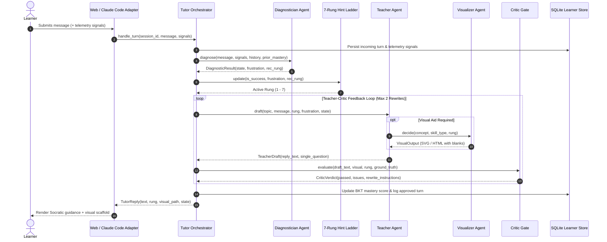

# Socratic Tutor v2: Architecture Specification

Socratic Tutor v2 is a local-first, multi-agent pedagogical framework built in Python and backed by SQLite. Its foundational invariant is: **never give the answer directly, but actively structure dialogue and visual intuition until the learner sees it.**

---

## 1. High-Level System Architecture

Socratic Tutor v2 provides one shared, deterministic Python core accessible through two distinct doors:

```mermaid
graph TD
    subgraph Adapters ["Adapters (Doors)"]
        CC["Claude Code Adapter<br/>(/socratic)"]
        WEB["Web Adapter<br/>(FastAPI + Vanilla JS)"]
    end

    subgraph Core ["Socratic Core (In-Process)"]
        ORCH["Tutor Orchestrator"]
        LADDER["7-Rung Hint Ladder"]
        LEARNER["Learner Model (BKT + Ebbinghaus)"]
        LLM["LLM Client Abstraction<br/>(Anthropic / Gemini / OpenAI / Mock)"]

        subgraph Agents ["Cooperating Multi-Agent Loop"]
            DIAG["Diagnostician Agent<br/>(Affect & Telemetry)"]
            TEACH["Teacher Agent<br/>(One-Question Rule)"]
            VIS["Visualizer Agent<br/>(Skills Dispatcher)"]
            CRITIC["Critic Quality Gate<br/>(Synchronous Leak & Rule Gate)"]
        end

        subgraph Skills ["Multimodal Skills & Sandbox"]
            ELI5["ELI5 Everyday Analogies"]
            DIAG_SKILL["Mermaid Diagrams (with Blanks)"]
            TRACE["Python Sandboxed Execution Tracer"]
            ANALOGY["Curriculum Mental Models"]
            PLOT["Matplotlib Complexity Curves"]
            THREE_D["Three.js 3D Spatial Plugin"]
            MANIM["Manim Animation Plugin (Optional)"]
        end
    end

    subgraph Storage ["Local Storage"]
        SQLITE[("SQLite Database<br/>(Local & Private)")]
        DASH["Static Mastery Dashboard"]
    end

    CC -->|CLI: ask / dashboard| ORCH
    WEB -->|POST /api/chat + signals| ORCH
    ORCH --> DIAG
    DIAG --> LADDER
    LADDER --> TEACH
    TEACH -->|Optional Visual Request| VIS
    VIS --> Skills
    TEACH --> CRITIC
    CRITIC -->|Rewrite Feedback (Max 2)| TEACH
    CRITIC -->|Approved Output| ORCH
    ORCH --> LEARNER
    LEARNER --> SQLITE
    SQLITE --> DASH
    WEB -.->|Embeds| DASH
```

---

## 2. The Turn Lifecycle

For every turn submitted by a learner, the system executes an automated 6-step loop:



---

## 3. The 7-Rung Hint Ladder

The hint ladder prevents learners from getting permanently trapped while guaranteeing that the answer is never leaked prematurely:

| Rung | Name | Pedagogical Purpose | Direct Answer Permitted? |
|---|---|---|:---:|
| **1** | **Probe** | Elicits existing mental model. "What do you think happens first?" | ❌ Strictly Forbidden |
| **2** | **Narrow Question** | Decomposes problem into a smaller, concrete sub-step. | ❌ Strictly Forbidden |
| **3** | **Analogy / ELI5** | Relates concept to everyday life (e.g., Russian dolls, plate stacks). | ❌ Strictly Forbidden |
| **4** | **Visual with Blanks** | Structured diagram, plot, or execution trace containing `[???]` blanks. | ❌ Strictly Forbidden |
| **5** | **Worked Example** | Fully solves a *different* but structurally isomorphic problem. | ❌ Strictly Forbidden |
| **6** | **Partial Reveal** | Reveals the key invariant or formula step; asks learner to complete it. | ❌ Strictly Forbidden |
| **7** | **Full Explanation + Check** | Direct explanation, followed *immediately* by a transfer check question. | ✅ Permitted with Check |

### Escalation & De-escalation Rules
1. **Escalation**: The ladder advances by +1 rung if:
   - The learner fails 2 consecutive attempts on the same rung.
   - The Diagnostician detects frustration $> 0.7$.
   - The session has remained on the current rung for $> 3$ turns.
2. **De-escalation**: After successful comprehension, the ladder steps back down (-1 rung) to fade scaffolding and foster self-reliance.

---

## 4. Cooperating Agents

1. **Diagnostician Agent (`core/agents/diagnostician.py`)**:
   - Assesses learner mental state: `LEARNING`, `STUCK`, `MASTERY`, `COPYING_SUSPECTED`.
   - Computes cognitive frustration on a continuous scale $[0.0, 1.0]$.
   - Runs a 3-question conceptual diagnostic on a learner's first session.
   - Employs deterministic heuristics for behavioral signals (paste length, idle latency, tab switching).

2. **Teacher Agent (`core/agents/teacher.py`)**:
   - Formulates pedagogical responses strictly respecting the active ladder rung.
   - Strictly enforces the **One-Question Rule**: exactly one question per turn.
   - Forbids code dumps; supplies skeletons with blanks.

3. **Visualizer Agent (`core/agents/visualizer.py`)**:
   - Consults curated curriculum templates (`curriculum/`) or synthesizes visuals dynamically.
   - Dispatches rendering to skills: `eli5`, `diagram`, `trace`, `analogy`, `plot`, `three_d`, `manim`.
   - Invariant: all visuals below Rung 7 must contain missing pieces or prediction prompts.

4. **Critic Agent (`core/agents/critic.py`)**:
   - Acts as an uncompromising synchronous gate on every teacher reply.
   - Employs hybrid checking:
     - Deterministic regex/heuristic filters (code dumps, multiple `?`, forbidden reveal phrases).
     - Semantic LLM verification with ground-truth comparison.
   - Rejects drafts that leak solutions before Rung 7, supplying actionable rewrite instructions.

---

## 5. Sandboxed Python Execution Tracer (`skills/trace/`)

The trace skill allows learners to run Python code step-by-step:
- **Process Isolation**: Executes in a dedicated subprocess with a strict 5.0s timeout.
- **AST Pre-Execution Validation**: Rejects dangerous imports (`os`, `sys`, `subprocess`, `socket`, `urllib`, `requests`) and dangerous built-ins (`eval`, `exec`, `compile`, `open`, `__import__`).
- **Interactive UI**: Generates self-contained HTML highlighting line numbers, call stack depth, local variables, and stdout with a predict-first card.

---

## 6. Learner Model & Spaced Mastery

The learner store (`core/learner.py`) combines:
1. **Bayesian Knowledge Tracing (BKT)**:
   - Prior knowledge $P(L_0) = 0.2$
   - Transition probability $P(T) = 0.15$
   - Guess probability $P(G) = 0.20$
   - Slip probability $P(S) = 0.10$
2. **Ebbinghaus Forgetting Decay**:
   $$\text{Mastery}(t) = \text{Score} \times e^{-\frac{\Delta t}{S}}$$
   Allows the system to identify decayed concepts requiring spaced repetition.

