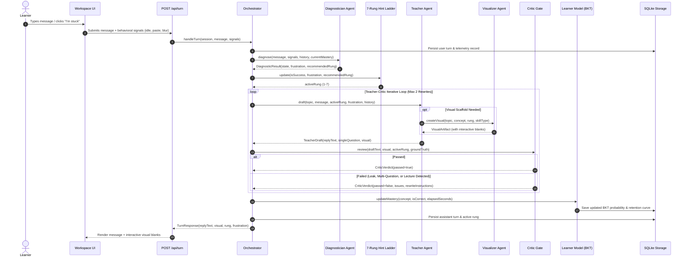

# Socratic Tutor v2: Architecture Specification

Socratic Tutor v2 is a local-first, multi-agent pedagogical web application built in **TypeScript and Next.js (App Router)** and backed by **Node 24 native SQLite (`node:sqlite`)**.

Its foundational invariant is: **never give the answer directly below Rung 7, but actively scaffold mental models through dialogue and interactive visual blanks until the learner sees the insight.**

---

## 1. High-Level System Architecture

Socratic Tutor v2 unifies the user interface, API endpoints, multi-agent pedagogical loop, visual skills registry, and autonomous evaluation harness within a single TypeScript codebase:

```mermaid
graph TD
    subgraph Client ["Browser Client (Hallmark Modern-Minimal Theme)"]
        UI_HOME["Landing Page (/)"]
        UI_SESS["Session Workspace (/session/[id])"]
        UI_DASH["Mastery Dashboard (/dashboard)"]
        WORKER_PY["Pyodide Web Worker (Python Tracer)"]
        WORKER_JS["Sandboxed Web Worker (JS Tracer)"]
        TELEM["Client Telemetry Collector (Paste/Idle/Blur)"]
    end

    subgraph Server ["Next.js App Router (Node 24 LTS)"]
        API_TURN["POST /api/turn"]
        API_SESS["GET /api/session/[id]"]
        API_DASH["GET /api/dashboard"]
        API_SETUP["GET /api/setup"]

        subgraph Core ["Socratic In-Process Core"]
            ORCH["Orchestrator Loop"]
            LADDER["7-Rung Hint Ladder"]
            LEARNER["Learner Model (BKT + Ebbinghaus)"]
            LLM["Multi-Provider LLM Abstraction<br/>(Anthropic / OpenAI / Gemini / Ollama / Mock)"]

            subgraph Agents ["Four Cooperating Agents"]
                DIAG["Diagnostician Agent<br/>(Frustration & Cognitive State)"]
                TEACH["Teacher Agent<br/>(Socratic Questioning & Scaffolding)"]
                VIS["Visualizer Agent<br/>(Visual Artifact Generation)"]
                CRITIC["Critic Quality Gate<br/>(Synchronous Leak & Rule Gate)"]
            end

            subgraph Skills ["Multimodal Visual Skills Registry"]
                ELI5["ELI5 Everyday Analogies"]
                DIAG_SKILL["Mermaid Diagrams (with Blanks)"]
                TRACE["Execution Trace Predictor"]
                ANALOGY["Mental Models"]
                PLOT["Complexity Curves (SVG)"]
                ANIM["Step Animation Engine"]
                THREE_D["Spatial 3D Model Plugin"]
            end
        end

        subgraph Storage ["Local-First Persistence"]
            SQLITE[("Node 24 native node:sqlite<br/>(data/tutor.db)")]
        end
    end

    UI_SESS -->|POST message + telemetry| API_TURN
    UI_SESS -->|Client-side tracing| WORKER_PY
    UI_SESS -->|Client-side tracing| WORKER_JS
    API_TURN --> ORCH
    ORCH --> DIAG
    DIAG --> LADDER
    LADDER --> TEACH
    TEACH -->|Visual Request| VIS
    VIS --> Skills
    TEACH --> CRITIC
    CRITIC -->|Rewrite Feedback (Max 2)| TEACH
    CRITIC -->|Approved Response| ORCH
    ORCH --> LEARNER
    LEARNER --> SQLITE
    API_DASH --> SQLITE
    API_SESS --> SQLITE
```

---

## 2. Multi-Agent Turn Lifecycle

Every interaction turn is processed through a strict multi-agent coordination loop:



---

## 3. The 7-Rung Hint Ladder State Machine

The Hint Ladder guarantees that a learner is never trapped in an unhelpful loop. It adapts dynamically according to mastery, frustration, and consecutive failures:

```
[Rung 1: Probe]
   │  (2 consecutive wrong answers OR frustration > 0.7)
   ▼
[Rung 2: Narrow Question]
   │
   ▼
[Rung 3: Analogy]
   │
   ▼
[Rung 4: Visual Scaffold with Blanks]
   │
   ▼
[Rung 5: Worked Example (with partial blank)]
   │
   ▼
[Rung 6: Partial Reveal (answer with key blank)]
   │
   ▼
[Rung 7: Full Explanation + Immediate Transfer Check]
```

### State Transition Invariants
1. **Escalation Trigger**: Active rung increases by +1 when:
   - Learner commits 2 consecutive incorrect attempts.
   - Diagnostician measures frustration $> 0.70$.
   - More than 3 turns have elapsed on the current rung without concept progression.
   - Learner explicitly clicks the *"I'm stuck"* rescue button.
2. **De-escalation Trigger**: Active rung steps down by -1 upon a correct answer to maintain productive struggle.
3. **Leak Gate Invariant**: Below Rung 7, the Critic Gate rejects any response that states the direct answer. On Rung 7, the full explanation is paired with a mandatory transfer check question.

---

## 4. Learner Model: BKT & Ebbinghaus Forgetting Curve

Student knowledge is modeled dynamically using Bayesian Knowledge Tracing (BKT) combined with an Ebbinghaus retention decay function.

### Bayesian Knowledge Tracing (BKT)

The probability that a learner has mastered concept $k$ at turn $t$, denoted $P(L_t)$, is updated as follows:

1. **Observation Update**:
   $$P(L_{t|\text{obs}}) = \begin{cases} \frac{P(L_{t-1}) \cdot (1 - P(S))}{P(L_{t-1}) \cdot (1 - P(S)) + (1 - P(L_{t-1})) \cdot P(G)}, & \text{if response is correct} \\ \frac{P(L_{t-1}) \cdot P(S)}{P(L_{t-1}) \cdot P(S) + (1 - P(L_{t-1})) \cdot (1 - P(G))}, & \text{if response is incorrect} \end{cases}$$
   Where:
   - $P(L_0) = 0.10$ (Initial prior probability of mastery)
   - $P(T) = 0.20$ (Probability of learning transition per turn)
   - $P(G) = 0.25$ (Probability of guessing correctly without mastery)
   - $P(S) = 0.10$ (Probability of slipping: incorrect despite mastery)

2. **Transition Update**:
   $$P(L_t) = P(L_{t|\text{obs}}) + (1 - P(L_{t|\text{obs}})) \cdot P(T)$$

### Ebbinghaus Memory Retention Decay

Between practice sessions, concept mastery decays according to memory stability $S$:

$$R(\Delta t) = e^{-\frac{\Delta t}{S}}$$

Where $\Delta t$ is elapsed time in days, and $S$ increases with repeated successful recall sessions:

$$S = S_0 \cdot (1 + \text{rehearsal\_count} \cdot 0.5)$$

---

## 5. Sandboxed Client-Side Execution Tracing

To provide safe, real-time code execution tracing without exposing the server to Remote Code Execution (RCE), all execution runs entirely inside browser Web Workers:

1. **Python Tracer (`public/workers/pyodide-worker.js`)**:
   - Loads WebAssembly-compiled Pyodide inside a background Web Worker.
   - Implements `sys.settrace()` to capture local variables, line numbers, and call stack frames at each execution step.
   - Outputs structured stack frames with interactive blanks (`?`) for user prediction.
   - Runs in isolated browser sandbox with zero network or filesystem privileges.
2. **JavaScript Tracer (`public/workers/js-worker.js`)**:
   - Executes code inside a sandboxed Web Worker.
   - Instruments AST nodes to record call depth and variable state changes.
   - Implements a strict **5-second execution timeout** (`setTimeout` worker termination) to neutralize infinite loops.
3. **Zero-Server Execution Guarantee**:
   - The Next.js Node.js server never executes untrusted code under any circumstances.

---

## 6. Database Schema (`storage/schema.sql`)

Persistence uses Node 24 native SQLite (`DatabaseSync`):

```sql
CREATE TABLE IF NOT EXISTS learners (
  id TEXT PRIMARY KEY,
  name TEXT NOT NULL,
  created_at INTEGER NOT NULL
);

CREATE TABLE IF NOT EXISTS sessions (
  id TEXT PRIMARY KEY,
  learner_id TEXT NOT NULL,
  topic TEXT NOT NULL,
  current_rung INTEGER NOT NULL DEFAULT 1,
  created_at INTEGER NOT NULL,
  updated_at INTEGER NOT NULL,
  FOREIGN KEY (learner_id) REFERENCES learners(id)
);

CREATE TABLE IF NOT EXISTS turns (
  id TEXT PRIMARY KEY,
  session_id TEXT NOT NULL,
  turn_number INTEGER NOT NULL,
  role TEXT NOT NULL,
  content TEXT NOT NULL,
  visual_artifact TEXT,
  critic_verdict TEXT,
  created_at INTEGER NOT NULL,
  FOREIGN KEY (session_id) REFERENCES sessions(id)
);

CREATE TABLE IF NOT EXISTS mastery (
  learner_id TEXT NOT NULL,
  topic TEXT NOT NULL,
  concept TEXT NOT NULL,
  p_mastery REAL NOT NULL DEFAULT 0.1,
  last_practiced INTEGER NOT NULL,
  practice_count INTEGER NOT NULL DEFAULT 1,
  PRIMARY KEY (learner_id, concept),
  FOREIGN KEY (learner_id) REFERENCES learners(id)
);

CREATE TABLE IF NOT EXISTS mistakes (
  id TEXT PRIMARY KEY,
  learner_id TEXT NOT NULL,
  topic TEXT NOT NULL,
  misconception TEXT NOT NULL,
  occurred_at INTEGER NOT NULL,
  resolved INTEGER NOT NULL DEFAULT 0,
  FOREIGN KEY (learner_id) REFERENCES learners(id)
);

CREATE TABLE IF NOT EXISTS signals (
  id TEXT PRIMARY KEY,
  turn_id TEXT NOT NULL,
  signal_type TEXT NOT NULL,
  signal_value TEXT NOT NULL,
  created_at INTEGER NOT NULL,
  FOREIGN KEY (turn_id) REFERENCES turns(id)
);
```
